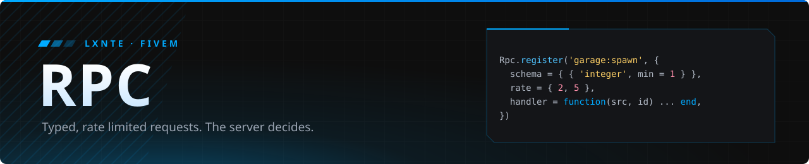

<p align="center">
  
</p>

<p align="center">
  
  
  
</p>

Request/response for FiveM, where every call from a client is checked before it reaches your code. The client only asks. The server validates, limits and decides.

### Why

Every exploit that hands out money starts with an event like `TriggerServerEvent('shop:buy', -999999)`. With this library, a handler only runs after:

- **Schema.** Argument types, `min` / `max`, string length, `oneOf` lists and table size, depth and node count. `NaN`, `inf` and extra arguments are rejected.
- **Rate limit.** A token bucket per player and per call, with burst. Floods are reported once, not on every hit.
- **One at a time.** A slow handler cannot be run twice in parallel by the same player (opt out with `parallel = true`).
- **Errors contained.** A failing handler returns `nil` to the caller and reports to your hook. It never leaves a promise hanging.

Large replies are sent as latent events through one lane per player, so a big payload does not block that player's game traffic.

### Install

Add it to the resource that uses it:

```lua
server_script '@fivem-rpc/server.lua'
client_script '@fivem-rpc/client.lua'
```

```cfg
ensure fivem-rpc
```

Event names are prefixed with the resource name, so two resources never collide.

### Usage

**Server**

```lua
Rpc.register('garage:spawn', {
    schema = { { 'integer', min = 1 } },
    rate = { 2, 5 },
    handler = function(src, vehicleId)
        local vehicle = Garage.owned(src, vehicleId)
        if not vehicle then return false end
        return Garage.spawn(src, vehicle)
    end,
})

Rpc.register('chat:send', {
    schema = {
        { 'string', min = 1, maxLen = 200 },
        { 'string', oneOf = { 'local', 'ooc' }, optional = true },
    },
    handler = function(src, text, channel) end,
})

Rpc.emit(src, 'garage:spawned', netId)
```

**Client**

```lua
local netId = Rpc.call('garage:spawn', 12)
if not netId then
    print(Rpc.status)
end

Rpc.send('chat:send', 'hello', 'ooc')

Rpc.on('garage:spawned', function(netId) end)
```

`Rpc.call` blocks the current thread and returns whatever the handler returned. On failure it returns `nil` and sets `Rpc.status` to `'timeout'`, `'limited'` or `'refused'`.

### Schema rules

| Field | Applies to | Meaning |
| --- | --- | --- |
| `type` / `[1]` | all | `number`, `integer`, `string`, `boolean`, `table` |
| `min`, `max` | numbers | inclusive range |
| `min`, `maxLen` | strings | length range (default max 1024) |
| `maxLen` | tables | top-level entries (default 256) |
| `oneOf` | all | allowed values |
| `optional` | all | `nil` allowed |

### Hooks and config

```lua
Rpc.onViolation(function(src, kind, name)
end)

Rpc.onError(function(name, src, err)
end)

Rpc.configure({ rate = { 10, 10 }, flood = { 30, 10 }, latentAbove = 900 })
```

`kind` is `'schema'`, `'flood'` or `'bad_id'`. Call `Rpc.configure` before registering your calls. On the client, `Rpc.configure({ timeout = 10000, debug = true })`.

| Server | Client |
| --- | --- |
| `Rpc.register(name, def)` | `Rpc.call(name, ...)` |
| `Rpc.emit(target, name, ...)` | `Rpc.callLatent(name, bps, ...)` |
| `Rpc.latent(target, event, bps, ...)` | `Rpc.send(name, ...)` |
| `Rpc.onViolation(fn)` | `Rpc.sendLatent(name, bps, ...)` |
| `Rpc.onError(fn)` | `Rpc.on(name, fn)` |

<p align="center"><sub>MIT · made by <a href="https://github.com/lxnte">LXNTE</a></sub></p>
